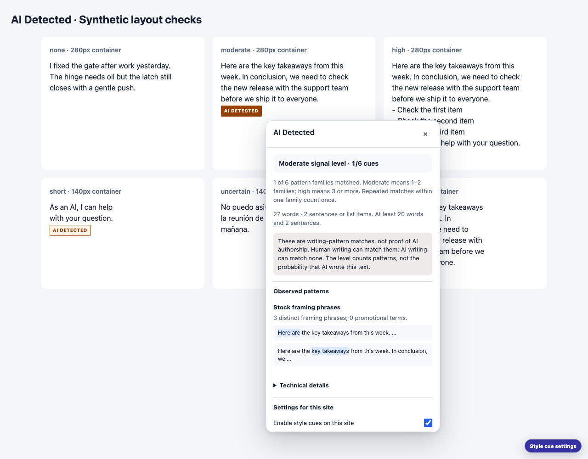

# AI-Style Signal Userscripts

[](https://github.com/christopherrbrown3/ai-detection-userscripts/actions/workflows/ci.yml)
[](LICENSE)

A privacy-first Safari userscript that shows observable writing-style cues on posts and comments on LinkedIn, X/Twitter, and Reddit, with experimental Facebook and YouTube support.

> [!IMPORTANT]
> This project analyzes surface writing patterns. It cannot prove who or what wrote a post. Short, edited, personalized, multilingual, and mixed-authorship text may be impossible to classify reliably. Never use a badge as the basis for an accusation or high-stakes decision.



## Install

1. Install [Userscripts for Safari](https://github.com/quoid/userscripts).
2. Open **[Install AI-Style Cues — all supported sites](https://raw.githubusercontent.com/christopherrbrown3/ai-detection-userscripts/main/ai-style-cues.userscripts.user.js)** in Safari.
3. Accept the Userscripts installation prompt and grant access to the supported sites you want to use.
4. If upgrading from the three site scripts, disable those scripts and refresh your tabs. Follow the [migration and rollback guide](docs/migration.md) to keep your settings and backups.

One self-contained script supports LinkedIn, X/Twitter, and Reddit, plus opt-in Facebook and YouTube desktop text analysis. Only the adapter for the current site runs. Instagram, Threads, and Bluesky are not yet supported. See the generated [supported-site and route matrix](docs/supported-sites.md).

**Facebook starts disabled.** On `www.facebook.com`, open **Style cues off · Settings** and turn on **Enable style cues on this site**. Version 0.6 adds `www.facebook.com` and `facebook.com` to the combined script's permissions; Safari may require website access before the launcher appears. Facebook is experimental: live Safari checks cover feed, profile/Page, permalink/dialog, comments/replies, and preference persistence, alongside synthetic regressions. Some layouts will be skipped. See [Facebook scope and validation](docs/facebook-validation.md).

**YouTube starts disabled.** On `www.youtube.com`, open **Style cues off · Settings** and turn on **Enable style cues on this site**. Version 0.7 adds only `www.youtube.com` to the combined script's permissions. It analyzes creator descriptions, comments/replies, and supported channel Posts text. Titles, transcripts, live chat, Shorts, polls, and media analysis are excluded. Some layouts are skipped; see [YouTube scope and validation](docs/youtube-validation.md).

Optional targeted installations retain their existing names, update URLs, and narrower host permissions:

| Site | Optional install | Coverage |
| --- | --- | --- |
| LinkedIn | [LinkedIn script](https://raw.githubusercontent.com/christopherrbrown3/ai-detection-userscripts/main/linkedin-ai-heuristic.userscripts.user.js) | Feed, profile activity, direct post permalinks, and comments |
| X/Twitter | [X script](https://raw.githubusercontent.com/christopherrbrown3/ai-detection-userscripts/main/x-ai-heuristic.userscripts.user.js) | Posts and replies |
| Reddit | [Reddit script](https://raw.githubusercontent.com/christopherrbrown3/ai-detection-userscripts/main/reddit-ai-heuristic.userscripts.user.js) | Current Reddit, old Reddit, posts, and comments |
| Facebook | [Facebook script](https://raw.githubusercontent.com/christopherrbrown3/ai-detection-userscripts/main/facebook-ai-heuristic.userscripts.user.js) | Experimental desktop published-text markers and permalink-identified comments/replies; opt-in |
| YouTube | [YouTube script](https://raw.githubusercontent.com/christopherrbrown3/ai-detection-userscripts/main/youtube-ai-heuristic.userscripts.user.js) | Experimental desktop descriptions, comments/replies, channel Posts and post permalinks; opt-in |

Manual installation: open Userscripts → Manage → Open Scripts Folder, copy the desired root-level `.user.js` file there, enable it, and refresh the target site. Keep only your intended installation enabled. Do not install the metadata-only `.meta.js` files.

### Compatibility

The target is the current [Userscripts](https://github.com/quoid/userscripts) extension on Safari 16.4+ for macOS. The scripts include fallbacks for older emoji/CSS support, but older Safari releases and iOS layouts are best-effort rather than part of the automated fixture matrix. Current automated layouts cover LinkedIn feed posts/comments, profile activity, direct post permalinks, collapsed/expanded post text, X posts/replies, current Reddit posts/comments, old Reddit posts/comments, synthetic Facebook desktop posts/dialogs/comments/replies, and YouTube descriptions/comments/channel Posts. Facebook mobile hosts, Groups routes, messaging, Stories, Reels, and Marketplace are excluded. YouTube mobile, Music, Studio, embedded players, Shorts, and live chat are excluded.

## What the badge means

Posts with enough matched evidence get a small **AI Detected** stamp beside the title or author at the top of the post. If a recognizable header is unavailable, the stamp sits above the text. Its height matches the post's text line height. Posts with too little evidence, or text the English rules cannot assess, have **no badge**.

Evidence is scored with fixed, documented points (version 0.10):

| Tier | Points | Families |
| --- | --- | --- |
| Strong artifact | 3 | Model self-reference or knowledge-cutoff disclaimer; unedited assistant output (preambles such as "Sure! Here's a revised version:", sign-offs, unfilled `[Your Name]` placeholders); assistant markup (`oaicite` citations, chat tokens, literal Markdown on sites that do not render it) |
| Pattern | 1 | Link copied from an AI assistant (`utm_source=chatgpt.com` and similar); stock framing phrases; chatbot social-post register ("Hey fellow Redditors", "any advice would be greatly appreciated", "thanks in advance"; two distinct phrases); repeated "not X, but Y" pivots; words LLMs overuse; copula avoidance and trailing "-ing" clauses; repeated sentence openings; similar sentence lengths; repeated phrases |
| Formatting | 0.5 | Lists and colon/dash structure; Title Case headings; creator-post template (hook line, one-line paragraphs, bullets, an engagement prompt or hashtag block). These count only alongside another family |

- **Grey dashed / Possible AI:** some evidence matched, but less than a moderate stamp needs (Balanced and Sensitive only).
- **Orange / moderate (AI Detected):** 1–2.5 points.
- **Red / high (AI Detected):** 3 points or more. Without a strong artifact, high also needs both word-choice and structure evidence. A double border distinguishes high without relying only on color.
- **Rhythm and repetition alone** (openings, sentence lengths, repeated phrases) need two such families to stamp: each matched 2–5% of pre-ChatGPT human answers on its own.
- **Short samples** (fewer than 20 words or 2 sentences) stamp only on a strong artifact.
- **Hover:** details grow out from the stamp, showing the matched families and highlighted passages. Moving into the panel keeps it open.
- **Click, tap, Enter, or Space:** keep details open for reading and interaction. Escape closes them and returns focus. Reduced-motion settings disable the grow animation.

The level reflects fixed evidence points, not the probability that AI wrote the post. Human writing can match these patterns; AI writing can match none. The details show each matched family with its tier, the point total, highlighted passages, sample length, and exclusions. **Short sample** is reported in details and the accessible name. The original post is never highlighted or rewritten.

Multiple matches in a family count once. Lists are excluded from the prose rhythm, repetition and contrast checks; counted openings are excluded from phrase repetition. See the [0.10 accuracy validation](docs/accuracy-validation.md) for measured rates per sensitivity.

The **Style cue settings** button remains available when every badge is hidden. Settings are stored locally for the current site/origin:

- enable or disable analysis on this site
- comments/replies on or off
- hide signals in short samples
- **Stamp sensitivity**, measured on RAID's Reddit posts from 2023–24 chat models (human / AI posts stamped):
  - **Strict:** AI Detected only. 1.1% / 49%.
  - **Balanced (default):** the same AI Detected stamps, plus Possible AI for weaker evidence. 7.8% / 53% with any stamp.
  - **Sensitive:** lower cut-offs; one rhythm, formatting or register cue can stamp, and the creator-post template counts as a pattern. 17% / 79%. Useful on LinkedIn if you would rather over-flag; LinkedIn itself is unmeasured.

Zero-match and unassessed posts always stay unbadged. Older saved settings remain readable; the old zero-match visibility preference no longer changes this behavior. See the [0.9 stamp validation report](docs/stamp-validation.md) and [0.9.1 header placement checks](docs/header-stamp-validation.md) for verification and limits.

## Privacy

All extraction and analysis happen inside the browser tab. The scripts:

- do not send post text, account data, browsing activity, scores, or feature vectors anywhere
- do not load a model, CDN asset, analytics SDK, or remote JavaScript dependency
- store only user settings locally, separated by site/origin; Facebook uses userscript-manager storage so the page cannot erase its preferences

See [SECURITY.md](SECURITY.md) for the privacy boundary and reporting guidance.

## Detection approach

The browser preserves paragraph, line-break, and list boundaries while extracting the author's text. It excludes quotation blocks, quoted reposts where identified by the site adapter, code, and inline quotation/code spans. One deterministic sentence parser supplies both the cue checks and diagnostic metrics, including handling of common abbreviations, decimals, and URLs.

The default rules look for exact, inspectable patterns. Sources include Wikipedia's [Signs of AI writing](https://en.wikipedia.org/wiki/Wikipedia:Signs_of_AI_writing), [Kobak et al. 2025](https://arxiv.org/abs/2406.07016), [Reinhart et al. 2025](https://arxiv.org/html/2410.16107v2) and [slop-score](https://github.com/sam-paech/slop-score) (MIT; see [third-party notices](THIRD_PARTY_NOTICES.md)):

- explicit model-reference, knowledge-cutoff and capability wording, excluding ordinary refusals and AI job titles
- unedited assistant output: openers, "here's a revised version:" delivery lines, sign-offs and Title Case placeholders; ironic `[insert joke here]` and Markdown link titles do not count
- assistant markup: role tokens, `oaicite`/`contentReference` and other citation remnants, and literal Markdown headings, bold lines or links on sites that do not render Markdown
- AI-assistant tracking parameters in linked URLs, read from link targets and through Facebook/YouTube redirect wrappers
- stock framing phrases scaled with length (two distinct phrases per 120 prose words); phrases as common in human answers as in ChatGPT output count only in threes, and `TL;DR` and "if you're" are ignored; inflection-aware promotional terms
- "not X, but Y" and "it isn't X. It's Y" pivots, ported from slop-score's surface regexes; ordinary in-sentence hedges count half
- several distinct LLM-overused words, and copula avoidance or trailing "-ing" clauses
- repeated multiword sentence openings (three repeats, or two sharing four words)
- bullet, arrow, checkmark, emoji, keycap and numbered lists or punctuation clusters; clock times and numeric ranges are not punctuation clusters
- similar prose sentence lengths, and contiguous repeated 3–5-word phrases measured relative to prose length

Unicode is normalized and invisible formatting characters are removed before analysis. The language check uses script and English function-word evidence; it is a conservative eligibility heuristic, not a language classifier.

Posts approaching the viewport are queued in small batches. Edits re-extract the affected post, unchanged text reuses its analysis, and a bounded cache shares results for duplicate content. Legacy stylometry, character n-gram hashing, and model output are deferred until **Technical details** is opened in the default uncalibrated release.

The root userscripts are generated from one registry, shared detector/runtime/bootstrap, and thin platform adapters. Messaging routes are excluded and editable composers are omitted from text extraction. The offline Python extractor mirrors the shared sentence and exclusion rules for diagnostic feature parity.

## Accuracy policy

The default installed behavior is an explicitly **heuristic cue rubric**, not a trained authorship classifier. Every rule, point value and threshold is hand-written and runs inside the userscript; nothing is trained. Unsupported or uncertain language is skipped, and posts below the stamp threshold have no badge. It makes no probability claim. Human professional writing can contain these patterns, while generated or heavily edited text can avoid them.

Version 0.10 measures the rubric on labeled text with `scripts/evaluate_rubric.mjs` and tunes cut-offs by hand against false-positive rates. On held-out RAID Reddit posts by 2023–24 chat models, AI Detected catches 49% of AI posts and 1.1% of human posts (0.9.1: 16.5% and 7.3%). On HC3's pre-ChatGPT human answers it stamps 0.4–0.7% in Strict. No labeled LinkedIn, X, Facebook or YouTube corpus was available, so those sites are unmeasured. ZipPy compression, Biber-style grammar rates and slop-score lists were measured but not shipped. See the [0.10 accuracy validation](docs/accuracy-validation.md).

Version 0.9 adds two rule-only checks from the [browser detection research](docs/research/2026-10-28-browser-ai-text-detection.md): recognizable assistant artifacts and repeated contrast constructions. No model training, inference runtime, new runtime dependency, or network service is needed. Diagnostic feature definitions and model weights are unchanged. The [stamp validation report](docs/stamp-validation.md) records the chosen rules and their limits.

Version 0.8 recognizes more combinations of framing, repeated openings, and list markers, and avoids treating examples such as “AI engineer” as a model self-reference. These rules will match more human writing too; a broader match is not evidence that detection accuracy has improved. See the [sensitivity validation](docs/sensitivity-validation.md) for the before-and-after probes and their limits.

The legacy experimental model output remains available only in Technical details for development comparison. A future trained model may replace the rubric only after a suitable distributable corpus and held-out report are published.

Versions 0.5.1–0.6.0 converted the count to 0–100, making one family always appear as **17**. Version 0.6.1 removes that misleading precision without changing the detector. See the [research grounding and accuracy audit](docs/research-grounding.md) for the version history, known misses/false matches, exact research-to-code gaps, and the evaluation required before changing the model. The [badge validation report](docs/badge-validation.md) records overflow regression checks and live Safari verification.

The offline pipeline enforces:

1. leakage-aware training, calibration, and test splits
2. held-out sigmoid calibration
3. a strong threshold derived only from held-out human scores at a requested false-positive target
4. separate reports by platform, content type, length, language, generator, attack, and authorship class
5. mixed-authorship evaluation without forcing mixed text into a binary training label

The full evaluation protocol and required robustness matrix are in [docs/benchmarking.md](docs/benchmarking.md).

## Development

Requirements: Python 3.10+ and Node.js 20+.

```bash
python3 -m pip install -r training/requirements.txt
npm install
npm run build
npm test
python3 -m unittest discover -s tests -p 'test_*.py' -v
```

Edit files under `src/` and `models/default-models.json`, then regenerate the root release files:

```bash
python3 scripts/build_userscripts.py
python3 scripts/build_userscripts.py --check
```

Tests cover feature parity between Python and JavaScript, cue spans, quotation/code exclusion, list overlap, scoring behavior, threshold selection, grouped splitting, nested DOM ownership, edited-content rescoring, cache reuse, viewport scheduling, and keyboard-accessible dialogs. See [v0.5 consolidation validation](docs/consolidation-validation.md) for generated-bundle parity, isolated-world coexistence, workload measurements, and verification limits. The [v0.4 cue validation](docs/browser-validation.md) records the earlier rule changes and list ablation. Architecture, the adapter contract, and a contributor template are documented in [adding sites](docs/adding-sites.md).

## Offline training

The pipeline accepts human, AI-generated, and mixed/hybrid JSONL records with optional platform, generator, language, attack, and source-group metadata. It can also normalize downloaded MultiSocial-style CSV, JSON, JSONL, or Parquet files.

See [training/README.md](training/README.md) for the schema, dataset preparation, adversarial augmentation, training, reporting, and safe model export workflow.

## Limitations

- Social posts are often shorter than reliable stylometry requires.
- A model trained on one platform or generator may fail on another.
- Paraphrasing, fine-tuning, personalization, human editing, and mixed authorship can reverse or erase useful signals.
- English-language learners, dialects, formulaic professional writing, and easy-to-read prose can be over-flagged by detectors.
- Site markup changes can temporarily break extraction; fixture tests cover known layouts but cannot guarantee future compatibility.

See [docs/troubleshooting.md](docs/troubleshooting.md) if badges are missing, duplicated, or misplaced.

## Research and license

[whitepapers/web_research.md](whitepapers/web_research.md) records the primary research behind the accuracy and UX decisions. Contributions should include evidence and an ablation or regression test for detection changes.

Released under the [MIT License](LICENSE).
